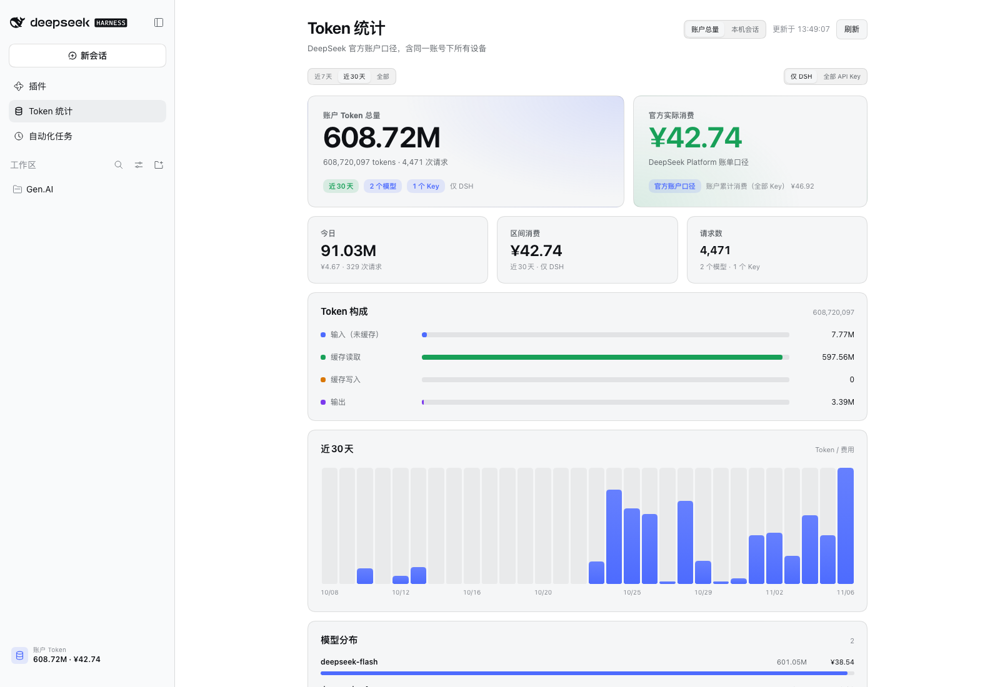

# DSH Token Atlas

> DSH 多端 Token 统计：本机会话账本 + DeepSeek 官方账户用量，左侧栏一眼看总账。



## 为什么需要它

DSH 的会话日志只在本机，统计本机会话时看不到其他设备；而 DeepSeek 账户的用量页又是**账户口径**，包含同一账号下所有设备、所有 API Key。两个数字天然不同，直接拿本机数字当“总消耗”就会对不上。

Token Atlas 把这两个口径分开呈现：

- **账户总量**：DeepSeek Platform 官方用量接口，覆盖同一账号下所有设备与 API Key；金额是官方实际扣费。
- **本机会话**：读取当前设备的 `~/.dsh/sessions`，回填历史会话，金额按官方峰谷价估算。

默认打开「账户总量」，顶部可随时切到「本机会话」。

## 功能

### 账户总量

- 官方 Token 总量：缓存命中、缓存未命中、输出、请求数
- 官方实际消费（CNY），按 DeepSeek Platform 账单口径
- 近 7 天 / 近 30 天 / 全部时间
- 仅 DSH / 全部 API Key
- 每日柱状图、模型分布、API Key 分布
- 账户累计消费（全部 Key）

### 本机会话

- 全部会话的 Token 汇总：未缓存输入、缓存读取、缓存写入、输出
- 首次扫描回填历史会话，之后增量更新并持久化账本
- 今日 / 本月、近 14 天柱状图、模型分布、最近会话
- 按官方 CNY 峰谷价估算金额；未定价模型单独标注

### 界面

- 左侧栏「Token 统计」入口
- 左下角设置上方的实时小卡：默认显示账户总量
- 固定 960px 内容宽度，账户/本机、7 天/30 天/全部切换不横跳
- 独立坐标轴，日期按柱子中心对齐

## 安装

### GitHub Release tarball（推荐）

```bash
dsh plugin --profile desktop add \
  https://github.com/HexMira/dsh-token-atlas/releases/download/v0.1.0/dsh-token-atlas-0.1.0.tgz
```

Web profile 把 `desktop` 换成 `web`。

### GitHub 源码

```bash
dsh plugin --profile desktop add github:HexMira/dsh-token-atlas
```

GitHub 来源通常需要 DSH 允许该包的构建脚本；本包没有构建步骤，按 DSH 提示放行即可。

### 本地开发

```bash
ln -sfn /path/to/dsh-token-atlas \
  ~/.dsh/profiles/desktop/node_modules/dsh-token-atlas
```

在 profile 的 `package.json` 添加：

```json
"dsh-token-atlas": "link:../../plugins/dsh-token-atlas"
```

在 `cordis.patch.yml` 添加：

```yaml
- insert:
    - id: token-atlas
      name: dsh-token-atlas
```

Windows 本地开发（PowerShell）用 junction 代替符号链接：

```powershell
New-Item -ItemType Junction `
  -Path "$env:USERPROFILE\.dsh\profiles\desktop\node_modules\dsh-token-atlas" `
  -Target "C:\path\to\dsh-token-atlas"
```

DSH HMR 会重载插件；如果侧栏入口没出现，刷新一次页面。桌面端也可以完全退出后重开。

## 数据口径

| 字段 | 账户总量 | 本机会话 |
|---|---|---|
| 数据源 | DeepSeek Platform 官方用量接口 | `$DSH_HOME/sessions` 会话日志 |
| 覆盖范围 | 同一账号下所有设备 / API Key | 当前这一台设备 |
| 金额 | 官方实际扣费 | 按官方峰谷价估算 |
| Token | 缓存命中 + 未命中 + 输出 | 未缓存输入 + 缓存读取 + 缓存写入 + 输出 |
| 历史 | 按 30 天窗口回溯 | 首次扫描回填 |

### 多设备为什么会对不上

账户总量包含所有设备，本机只包含当前设备；此外同一账号还可能有其他 API Key（例如自动化脚本、其他应用）。面板里的「全部 API Key」和「API Key 分布」可以直接看到差异来源。

Platform 用量接口只能按 **API Key / 模型**拆分，不能按设备拆分。如果你需要设备级拆分，给不同设备配不同的 DSH Key，或在「本机会话」里看当前设备明细。

### 隐私

- 账户 Token 只在 Host 端使用，不发送到浏览器
- 所有路由只接受本机 loopback 请求
- 不读取、不保存提示词、回复、工具内容或凭据
- 账本只保存 Token/模型/会话标题等统计信息

## 兼容性

- 纯 JavaScript/HTML/CSS，没有原生扩展、`.node`、`.dylib`、`.dll` 或架构相关二进制；同一个 tarball 适用于 **Intel Mac、Apple Silicon Mac、Windows**（以及 DSH 支持的 Linux Web）。
- 已在 Intel macOS + DSH `0.2.1-rc.2`（Node 24）实测；Apple Silicon 与 Windows 使用同一份 JS 运行时，理论上无需重新编译。
- 本机会话扫描依赖 DSH 运行时 Node 的 `zlib.zstdDecompressSync`（Node 22.15+/24）。DSH 0.2.x 自带 Node 24；如果宿主是更老的 Node，本机 `.zstd` 日志无法解压，但账户总量视图仍可用。
- Windows 的标题栏/窗口边距由 DSH 自己的 frame 处理；本插件只负责 960px 内容区。账户 API 的客户端标识会按平台发送 `darwin` / `desktop-win` / `web`。
- 未在本轮于 Apple Silicon/Windows 实机安装验证；发布后建议在另一台机器装一次 Release tarball，若有布局或路径问题我再修。

## 已知限制

- 账户视图使用 DeepSeek Platform 网页端的用量接口，不是公开、版本化的 API；如果 DeepSeek 调整接口，账户视图会显示不可用，本机视图仍可工作。
- 账户视图需要 DeepSeek **账号登录**（设置 → 账号与余额），只有 API Key 时回退到本机视图。
- Platform 接口单次最多 30 天；全部时间按 30 天窗口向前回溯，并缓存 5 分钟。
- 本地金额是估算，不是账单；价格表变化时需要更新 `lib/ledger.js` 中的 `PRICING`。
- 本地统计按北京时间分日、按北京时间峰谷计价。

## 开发

```text
lib/index.js    Host 入口：两条本地只读路由
lib/ledger.js   本机会话扫描、去重、账本持久化、估算
lib/account.js  DeepSeek Platform 账户用量聚合
lib/client.js   浏览器端：侧栏、主面板、账户/本机视图
```

客户端是手写的 `window.__ModuleLoader__` 模块，不需要构建步骤。

```bash
node --check lib/index.js
node --check lib/account.js
node --check lib/ledger.js
node --check lib/client.js
```

## License

MIT © 2026 Mirakovsky

---

## English summary

DSH Token Atlas is a DSH sidebar plugin for **multi-device token accounting**.
It keeps two totals separate: the **official DeepSeek account total** (all
devices and API keys, actual CNY spend) and **this device's local session
ledger** (historical backfill, estimated peak/off-peak cost). The account token
stays in the Host; the browser only receives aggregate statistics. Install from
the GitHub release tarball or `github:HexMira/dsh-token-atlas`.
